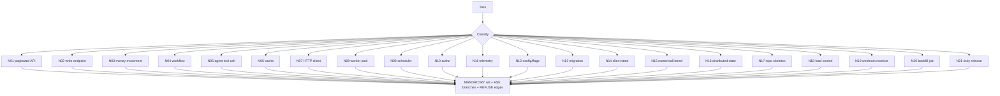

# Decision graph: task-type routing (deterministic pattern selection)

Purpose: pattern selection is a traversal, not a judgment call. Classify
the task into one node, collect its MANDATORY set, walk its ASK
predicates in order, obey its REFUSE edges, emit the ID set. The agent
never weighs alternatives; the graph decides. Deviations from a
MANDATORY entry need an ADR (PATTERN-CORE §5); ASK branches that cannot
be answered from the task requirements go to the user as a question, not
a guess.

## Traversal algorithm

1. **Classify.** Map the task to exactly one node below. If two apply
   (money movement inside a workflow), take both: union the MANDATORY
   sets and answer both ASK chains; overlaps are consistent by design.
2. **Collect.** The node's MANDATORY IDs are baseline; no discussion.
3. **Branch.** Walk ASK predicates top to bottom. Each predicate is a
   fact about the task; yes adds the IDs, no skips. Unknown predicate:
   ask the user.
4. **Refuse.** If the task matches a REFUSE edge, the redirect is not
   optional; the refused variant does not proceed in any form.
5. **Emit.** Output the ID set with the files to load. That set is the
   design; free-form pattern picking beyond it requires the failure mode
   to name a pattern outside the node (PATTERN-CORE §5 rule 1).

## Node index

| Node | Task | MANDATORY | Detail |
|---|---|---|---|
| N01 | Paginated collection API | P7 | §N01 |
| N02 | Mutating write endpoint | T1, T33, P42, P47 | §N02 |
| N03 | Money movement or split | T27, P11, P12 | §N03 |
| N04 | Multi-service workflow | T31, T32, T19 | §N04 |
| N05 | Agent tool call / LLM output | T48, T50, P33, P37 | §N05 |
| N06 | Cache layer | P21 | §N06 |
| N07 | Outbound HTTP client | P24, T33 | §N07 |
| N08 | Multi-tenant worker pool | P22, P23, P42 | §N08 |
| N09 | Scheduler / recurrence | P8 | §N09 |
| N10 | Authz / tenant data access | T8, P41 | §N10 |
| N11 | Telemetry setup | P42, P45 | §N11 |
| N12 | Config / feature flags | P47, P44 | §N12 |
| N13 | Schema migration / rewrite | P6 | §N13 |
| N14 | Client state / optimistic UI | T43, P5 | §N14 |
| N15 | Numerical kernel / backtest | P12, P13, P14, P15 | §N15 |
| N16 | Replicated / distributed state | T33, T34, T38 | §N16 |
| N17 | New repo / module skeleton | T13, T11, P48 | §N17 |
| N18 | Rate limiting / load control | T35, P27 | §N18 |
| N19 | Inbound webhook receiver | P54 | §N19 |
| N20 | Backfill / bulk data job | P56 | §N20 |
| N21 | Risky release / rewrite | P58 | §N21 |

## Edges per node

### N01 · Paginated collection API
**MANDATORY.** P7 (keyset snapshot cursors).
**ASK.** Multi-tenant data? add P41. Client infinite scroll or autosave
nearby? add P5 (epoch tags). Deeply nested UI data needs? add P3.
**REFUSE.** Offset pagination: replace with P7 (R5); no exception for
"small tables", the cursor costs one row.

### N02 · Mutating write endpoint
**MANDATORY.** T1 (parse at boundary), T33 (idempotency key), P42 (wide
event per request), P47 (config epoch pinned at ingress).
**ASK.** Money fields? extend to N03. PII in payload? add P4 (redaction)
and P43 (shredding if stored append-only). Downstream retry-exposed
calls? add P24 on the client side. Events emitted? add T32 (outbox).
Concurrent writers on the same entity? add P55 (optimistic concurrency).
**REFUSE.** Fire-and-forget writes that skip the outbox: route through
N04's T32 or do not emit.

### N03 · Money movement or split
**MANDATORY.** T27 (double-entry immutable ledger), P11 (remainder
partition), P12 (dimensional units), integer minor-units everywhere.
**ASK.** Reconciled against an external ledger? add P19 (homomorphic
checksums). Restatements possible? add T26 (bitemporal). Shared account
across strategies? add P17 (risk tokens).
**REFUSE.** Floating-point money (any amount, any language); mutable
balance columns as stored truth (R4); percentage math in floats.

### N04 · Multi-service workflow
**MANDATORY.** T31 (saga with semantic compensation), T32 (outbox+CDC),
T19 (durable replayable coroutines when the flow outlives a process).
**ASK.** Steps call third parties? add T33 per step. Initiated or
stepped by an agent? add N05 mandatory plus P36 (CoW dry-run diff).
Human approval gates? add P36.
**REFUSE.** Cross-service 2PC; recovery logic hand-rolled outside T19;
compensation actions that are not idempotent.

### N05 · Agent tool call / LLM structured output
**MANDATORY.** T48 (grammar-constrained decoding), T50 (capability
sandbox), P33 (state-hash loop breaker), P37 (repair parser before
retry).
**ASK.** Reads untrusted text? add P31 (quarantine). Multi-turn? add
P35 (prefix pinning). Multi-stage pipeline? add P39 (memoization).
Sub-agent spawning? add P40 (spend lease). Write access? add P36
(approved diff) and P44 (flag any new bypass paths).
**REFUSE.** `JSON.parse` on raw model output; agent writes without an
approval diff; retry loops without P33 (doom loops are a defect, not a
strategy).

### N06 · Cache layer
**MANDATORY.** P21 (caller-declared staleness, single-flight).
**ASK.** Market data or quotes? add P16 (decay widening). Semantic or
vector search? add P38 (symbolic partition) and P39 (exact memo tier).
Client-side optimistic state? route mutations through P5.
**REFUSE.** A global TTL as the only staleness policy; caching
authoritative writes.

### N07 · Outbound HTTP client
**MANDATORY.** P24 (success-refilled retry budget), T33 downstream
(idempotency on every retried endpoint), P51 (circuit breaker per
dependency).
**ASK.** Tail-latency-sensitive reads? add T39 (hedged requests).
Business tiers exist? add P27 (criticality propagation). Parses
third-party content? add P46 (capability manifest around the parser).
Multiple dependencies sharing one pool? add P52 (bulkhead partition).
**REFUSE.** Unbounded exponential backoff; retries on non-idempotent
endpoints without T33; bare HTTP calls with no breaker state.

### N08 · Multi-tenant worker pool
**MANDATORY.** P22 (weighted DRR fairness), P23 (AbortScope teardown),
P42 (wide events).
**ASK.** Poison-tenant blast radius matters? add T42 (shuffle sharding).
Latency-critical jobs? add P30 (flight recorder). Fault paths tested?
add P29 (Faulty<IO> in CI).
**REFUSE.** One shared FIFO across tenants; detached tasks outside an
AbortScope.

### N09 · Scheduler / recurrence
**MANDATORY.** P8 (dual-frame anchors: future events stored as civil
time plus zone plus rule).
**ASK.** Corrections to past facts? add T26 (bitemporal). Consumed by
backtests? add P13 (as-of joins). DST-sensitive? P8 covers it; verify
tzdata versioning is query-visible.
**REFUSE.** Future recurring events stored as UTC instants.

### N10 · Authz / tenant data access
**MANDATORY.** T8 (capabilities, no ambient authority), P41 (tenant
capability binding RLS).
**ASK.** Role/delegation logic beyond boolean checks? add T46 (Datalog
policy). Conserved quantities (grant balances, quotas)? add X5
operators per ADR-0001 (pilot tier).
**REFUSE.** Hand-written `WHERE tenant_id = ?` as the only control;
new repositories constructed without a tenant capability.

### N11 · Telemetry setup
**MANDATORY.** P42 (wide events), P45 (burn-rate paging for the
service), P63 (trace-context propagation on every hop).
**ASK.** Latency-critical daemon? add P30 (ring-buffer recorder). PII
can reach traces? add P4 and P43.
**REFUSE.** Scatter-shot `logger.info` as the primary observability;
static threshold paging; logs that cannot be joined by one trace ID.

### N12 · Config / feature flags
**MANDATORY.** P47 (epoch-pinned config snapshots). Flags specifically:
P44 (expiresAt + owner or the flag does not merge).
**ASK.** Forked/snapshot workers? add P28 (snapshot epoch pinning).
Per-request consistency questions? P47 already covers; do not add a
second mechanism.
**REFUSE.** Live-reloaded globals read mid-request; permanent "flags"
that are really configuration (route to P47).

### N13 · Schema migration / rewrite
**MANDATORY.** P6 (shadow-write parity gate for risky rewrites),
expand-contract shape.
**ASK.** Ledger or accounting data? add P19 (checksum diff oracle).
Event-sourced store? project rebuild (T21) instead of row migration.
Replacing a legacy path end to end? extend to N21 (P58 strangler, P59
adapter at the seam).
**REFUSE.** Big-bang cutover without parity evidence; migrations
without a tested rollback.

### N14 · Client state / optimistic UI
**MANDATORY.** T43 (declarative rendering), P5 (generation tags on
mutations).
**ASK.** Offline-capable? add T25 + T23 (local-first sync). Long
structured flows? add P10 (zipper continuations). Server-owned flow?
add T45 (hypermedia transitions) instead of a mirrored client machine.
Heavy nested data? add P3 (query hoisting).
**REFUSE.** Manual DOM/listener synchronization; duplicating the server
state machine in the client without T45.

### N15 · Numerical kernel / backtest
**MANDATORY.** P12 (units), P13 (as-of causal horizon), P14
(deterministic reductions), P15 (Finite<T> traps).
**ASK.** Live and historical paths? add P20 (unified replay envelope).
Parallelism? P14 is already mandatory; do not add ad-hoc reductions.
**REFUSE.** Naive threaded float sums; joins on calendar-date equality;
`NaN`-tolerant pipelines.

### N16 · Replicated / distributed state
**MANDATORY.** T33 (idempotency), T34 (fencing tokens), T38 (causal
tokens).
**ASK.** Offline or multi-master clients? add T23 (CRDTs) via T25.
Rebalancing expected? add T41 (bounded hashing). Tenant isolation
matters? add T42 (shuffle sharding).
**REFUSE.** Dual writes (use T32); leader leases without fencing;
wall-clock ordering assumptions.

### N17 · New repo / module skeleton
**MANDATORY.** T13 (functional core, imperative shell), T11 (structured
concurrency), P48 (layering fitness gate in CI), plus PATTERN-CORE §3
baseline tier for the applicable domains.
**ASK.** Quant domain? add N15 mandatory set. Agents? add N05 mandatory
set. Money? add N03 mandatory set.
**REFUSE.** Speculative factories (R1); interface seams added for
mocking (R2); layers without a fitness gate.

### N18 · Rate limiting / load control
**MANDATORY.** T35 (adaptive concurrency limits), P27 (criticality
propagation).
**ASK.** Multi-tenant fairness? add P22 (DRR). Client-side
counterpart? add P24 (retry budgets).
**REFUSE.** Static thresholds as the only control; criticality
vocabularies where everything is P0 (R8).

### N19 · Inbound webhook receiver
**MANDATORY.** P54 (signature verify, persist-then-process, dedupe on
delivery ID).
**ASK.** Consumer needs current state more than event order? add P9
semantics (re-pull on ping). Payload feeds projections? add T32 (the
stored payload rides the outbox). Payload feeds an agent? add P31
(untrusted input).
**REFUSE.** Trusting sender claims without signature verification;
processing inline inside the HTTP handler; state mutations keyed on
delivery order.

### N20 · Backfill / bulk data job
**MANDATORY.** P56 (idempotent units, checkpoint table, pacing).
**ASK.** Backfill accompanies a rewrite? add N13 (P6 parity gate).
Verifying ledger-shaped data? add P19 (checksum pass). Multi-tenant
tables? pace within P22 fairness so the backfill is just another tenant.
**REFUSE.** Unbounded `UPDATE` loops with no checkpoint; backfills on
hot tables without batching and pacing; non-idempotent backfill steps.

### N21 · Risky release / rewrite
**MANDATORY.** P58 (strangler fig: intercept at a seam, slice by
slice, per-slice rollback).
**ASK.** Legacy model at the boundary? add P59 (anti-corruption
adapter) and P1 (compatibility lenses). Data parity between old and
new? add P6 (shadow parity) per slice. Routing switches? carry P44
expiries so the scaffolding dies on a date.
**REFUSE.** Big-bang cutover; parallel-run scaffolding with no expiry;
a strangler with no traffic seam (if you cannot intercept, you cannot
safely rewrite).

## Worked chains

Common task shapes pre-resolved through the union rule; use them as
calibration for the traversal.

| Task statement | Nodes | Emitted set (beyond shared mandatory) |
|---|---|---|
| "Split a restaurant bill among friends, store shares, charge retry-safe" | N03 + N02 | T1, T33, P42, P47, T27, P11, P12; plus P24 + P51 on the payment call (N07) |
| "Agent reads support emails and issues refunds" | N05 + N04 + N03 | T48, T50, P33, P37, P31 (emails are untrusted), T31, T32, T19, P36 (refund needs approval diff), T27 + P11 ledger entries |
| "Paginated admin table over a multi-tenant audit log" | N01 + N10 | P7, T8, P41; plus P43 if PII is stored, P4 on render |
| "Rewrite the billing ingest path" | N13 + N21 | P6, P19 (ledger checksums), P58, P59 at the legacy seam, P44 expiries on routing flags |

## Overview

## Maintenance rules

1. New node: a task class appearing in three or more estate repos, with
   MANDATORY drawn only from canon IDs and REFUSE edges that cite a
   refusal (R1-R8) or a named failure mode.
2. Node edits are canon changes: CHANGELOG entry; MANDATORY additions
   that promote a non-baseline pattern need an ADR.
3. The graph never contradicts PATTERN-CORE §3; MANDATORY sets are
   supersets of the baseline tier for their domain.
